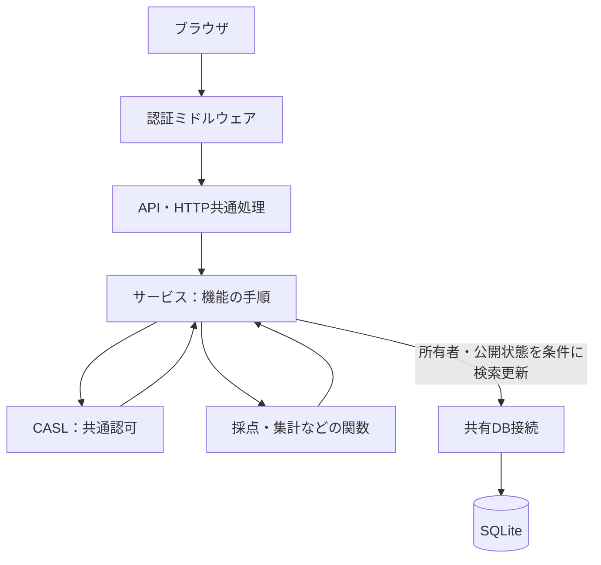

# 招待制インターネット公開の設計

合意日: 2026-11-03。対象: `app/`。本資料は設計合意の記録であり、公開対応の実装完了を意味しない。認証・認可・接続管理について既存資料のローカル限定・固定ユーザー前提より優先する。Rust学習側は変更しない。

## 利用者と機能

- 知り合い・同僚のうち、管理者が招待した人に提供する。一般の自由登録は設けない。
- 管理者は当面本人1人。問題の登録・修正・公開・公開停止、招待・利用停止、不備報告への対応を行う。
- 学習者は提供された過去問で演習し、中断再開・履歴・誤答復習・不備報告を利用する。問題は登録しない。管理者自身も学習できる。
- 回答・成績・進捗・履歴は本人のみが参照・操作する。管理者にも他人の学習履歴を閲覧する権限を付けない。
- 不備報告への対応では、対象問題と報告内容など必要な情報を扱い、報告者の学習履歴全体を公開しない。
- 過去問中心の範囲と既存履歴の保持を維持する。AI生成・画像/PDF取り込み・ランキング・利用者同士の成績共有は初回公開の必須機能にしない。

## 招待と認証

期限付き・1回限りの招待リンクを管理者が発行し、既存のメールやチャットなどで相手に直接渡す。アプリではメールアドレスを収集・保存・送信に使用しない。リンクの所持を登録の根拠とするため、メールによる本人確認は行わない。

利用者は任意のログインIDとパスワードを設定する。ログインIDに実名やメールアドレスを必須としない。内部ユーザーIDはログインIDと分離し、所有者の参照に使う。パスキーは初回必須にせず、後続で検討する。

実装時は招待の消費とアカウント作成を原子的に行い、同時登録や再送でも複数アカウントを作れないようにする。パスワードは専用の安全なハッシュ方式で保存する。招待トークン・パスワードをログに出さない。

認証ライブラリは `nuxt-auth-utils` を採用する。Cookieの保護とパスワードのハッシュ・照合機能を利用し、招待・復旧・DBでのセッション管理はアプリ側に実装する。パスワード保存は同ライブラリのscryptによるハッシュ機能を使用する。

ログイン成功時に推測困難なランダムなセッショントークンを生成し、保護されたCookieに格納する。SQLiteにはトークンのハッシュ、内部ユーザーID、有効期限、失効状態を保存する。保護されたAPIではCookieの検証に加え、トークンのハッシュでDBを検索し、セッションの有効期限・失効と利用者の停止状態を毎回確認する。Cookieだけでは認証を完了しない。役割はDBの最新値をCASLへ渡す。ログアウト時は対象セッションを失効し、利用停止・パスワード再設定時は当該利用者の全セッションを失効する。

パスワードを忘れた場合は、本人が既存の連絡手段で管理者に連絡し、管理者が本人確認したうえで期限付き・1回限りの再設定リンクを直接渡す。管理者が本人の新しいパスワードを設定・閲覧することはしない。再設定の完了とトークン消費・全セッション失効を原子的に行い、その後は通常のログインを求める。再設定トークンもハッシュで保存し、ログへ出さない。管理者本人の復旧手順は別途決める。

ログインIDのAES暗号化・HMAC保存は採用未決定であり、任意IDの合意とは区別する。

## CASLによる認可

CASLの採用を決定する。認証と認可は分離し、認証済みの内部ユーザーIDと役割から、リクエストごとの権限を組み立てる。ブラウザが申告する所有者IDや役割を信用しない。

| 対象 | 学習者 | 管理者 |
|---|---|---|
| 公開済み問題 | 演習用に取得 | 演習・管理 |
| 下書き・管理用問題情報 | 不可 | 取得・管理 |
| 招待・利用停止 | 不可 | 管理 |
| 自分の演習・回答・履歴 | 許可された操作のみ | 同左 |
| 他人の演習・回答・履歴 | 不可 | 不可 |
| 不備報告 | 自分の演習から送信 | 対応に必要な情報の参照・判断 |

管理者に全データへの包括的な許可を付けない。本人の回答でも、確定済み回答の書き換えなど業務ルールに反する操作は許可しない。演習用レスポンスには回答前の正解・解説を含めない。

CASLはDBや所有者情報を記憶しない。DBから取得した信頼できる対象データをsubjectとして渡し、所有者条件などと照合する。SQLite/Drizzleの検索条件は自動生成されないため、本人の内部ユーザーIDによる条件を共通処理で適用する。詳細だけでなく一覧・件数・更新にも適用し、CASLのルールとの一致を検証する。具体的な共通関数・変換方式は実装時に設計する。

画面の管理メニュー非表示は操作案内であり、APIとサービス側で必ず認可する。旧生成APIなど画面から見えない既存APIも公開前の認可確認対象とする。

## サーバーの責務と構成

以下は目標構成。ファイル名・細分化は実装時に調整する。

```text
app/server/
├── middleware/      セッションを確認して利用者を特定
├── auth/            認証・セッション・招待に関する処理
├── authorization/   CASLのルールと共通認可処理
├── api/             HTTP入力の取得・サービス呼び出し・レスポンス
├── utils/           HTTP共通処理（接続管理や権限ルールは分離）
├── services/        機能の手順・トランザクション・DB検索更新
└── db/              接続の生成・共有・終了、スキーマ・移行・保守
```

`services/`は取得→認可→業務上の検証→計算→保存という手順を担う。採点・集計は既存の独立した関数を活かす。現時点では`domain/`やドメインクラスを追加せず、Repository層の新設も必須としない。状態とルールの重複が増えた時点で再検討する。



CASLと採点関数はHTTPやDB接続のライフサイクルを管理しない。サービスがトランザクションを使って、一括で成功・失敗させる範囲を決める。

## DB接続の共有

永続ディスクを持つ単一Node.jsプロセスを基本とし、SQLite + better-sqlite3 + Drizzleを継続する。DB接続は`db/`で起動時または初回利用時に生成し、プロセス内で1つを再利用する。APIごとに生成・終了せず、サーバー終了時に閉じる。接続プールは導入しない。

- 利用者情報やCASLの権限を共有接続・グローバル変数に保持せず、リクエスト単位で渡す。
- トランザクションはサービス側で短く実行し、内部で外部通信や非同期の待機を行わない。
- 同期クエリとロック待ちはイベントループを占有する。接続共有だけで同時実行性能が保証されるとは扱わない。
- プロセスを増やすと接続も増える。SQLiteの同時書き込み制約は残る。
- 開発時の再読み込み、テストDB、CLI・バックアップ・復元の接続寿命を本番サーバーの共有接続と区別する。特に復元時は接続を閉じる手順を設計する。
- WAL、ロック待ち時間、終了処理、負荷基準の具体値・方式は未決定。公開前に検証する。
- PostgreSQLへの移行や接続プールは今回の採用事項ではない。

## 現状との差分と公開前の確認

現在は`local-admin.ts`等でローカル限定・固定ユーザーを確認し、`utils/*-http.ts`等で接続を開閉する。サービス内にDB操作とトランザクションがある。今回の文書変更ではコード・スキーマ・依存関係を変更しない。

公開対応の実装では、固定ユーザーを認証済み利用者に置き換え、既存履歴を元の本人へ保持する。認証・認可が完成する前にローカル限定の制限だけを解除しない。

公開前の受け入れ条件として、少なくとも次を具体的なテストにする。

- 未ログイン、利用停止、無効化済みセッションから保護されたAPIを利用できない。
- 招待なし・期限切れ・取り消し済み・使用済みリンクでは登録できず、同時消費も一度に限られる。
- 学習者は管理APIを利用できず、下書き情報を取得できない。
- 異なる利用者・管理者から他人の履歴や回答を取得・更新できない。一覧と件数も本人分のみ。
- 既存の再送制御・回答前の正解非公開・版と履歴の保持を維持する。
- 接続共有後もトランザクションのロールバック、リクエスト間の利用者分離、終了・復元・テストの独立性が維持される。

これらは今後の検証項目であり、実行済みではない。既存の品質ゲートを弱めず、ローカル検証・CI・本人受け入れを区別する。

## 残る判断

- 初期管理者の作成・管理者本人の復旧、セッションの有効期限・更新方式、Cookieの具体的設定。
- ログインIDの形式・正規化・変更可否・保存方式、パスワード要件、試行制限。
- 招待の有効期限と取り消し・再発行の具体的な操作。
- 管理者による本人確認の具体的手順と再設定リンクの有効期限。復旧方式自体は上記で合意済み。
- 過去問の登録と全員向け公開を分けるUI。下書き→管理者の試し解き→公開は提案段階であり、既存の登録即演習の仕様を黙って変更しない。
- 公開する問題の出典・共有可否の確認運用、退会・データ削除の扱い。
- 配置先、HTTPS・Cookie・CSRF対策、運用ログ、バックアップと復旧、同時利用の検証。

## 関連資料

- [実用アプリの技術方針](app-architecture.md)
- [過去問を中心にした初回リリース](past-exams-release.md)
- [初回リリース計画](first-release-plan.md)
- [CASL公式](https://casl.js.org/)

- [Nuxt Auth Utils公式資料](https://nuxt.com/modules/auth-utils)
