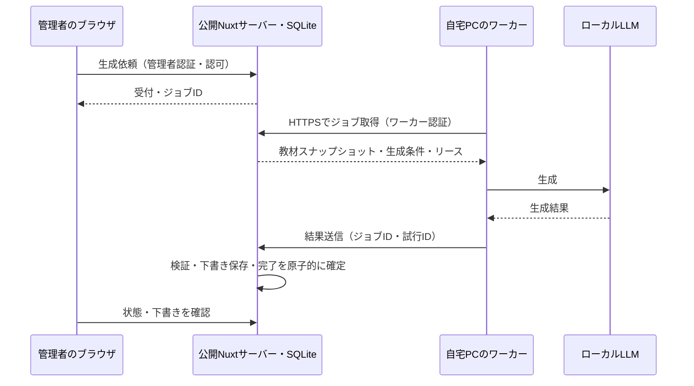

# 自宅PCのローカルLLMを利用する将来設計案

記録日: 2026-11-03。対象: 実用側 `app/`。本資料は将来の検討案であり、実装着手・方式の最終採用・稼働保証を意味しない。初回公開は過去問中心とし、AI生成を必須にしない。現行のAnthropic APIから始める方針、[招待制公開の設計](internet-release-design.md)を変更しない。

## 目的と推奨案

公開Webアプリから、自宅PCのローカルLLMで問題を生成できるようにする。自宅回線の固定IP契約やルーターのポート開放を前提にせず、自宅PCから公開サーバーへ接続する。

管理者による問題生成は完了を待てるため、**自宅PCのワーカーがHTTPSでジョブを取得する非同期方式を第一候補**とする。モデル・実行ソフト・PC性能は未選定。対話や逐次表示が必要になった場合はトンネル等を再検討する。

| 候補 | 接続と前提 | 判断 |
|---|---|---|
| ジョブ取得方式 | 自宅PCが公開サーバーから依頼を取得し、結果を送信。自宅の固定IP・受信ポート・公開LLM APIは不要 | 非同期の問題生成の第一候補。ジョブ管理の実装が必要 |
| Cloudflare Tunnel + Access | 自宅からトンネルを張り、公開アプリのサーバーが認証付きURLを呼ぶ | 疎通試験や即時呼び出しの候補。通常のTunnelとサービス認証を設定し、試験用Quick Tunnelを運用前提にしない |
| Tailscale | 公開サーバーと自宅PCをプライベートネットワークで接続 | 両側に接続環境を用意できるVPS等で候補。配置先の制約を確認する |

トンネル・VPNでもPC停止中は推論できない。固定IPの解消と可用性の確保は別に扱う。

## 構成と責務

- 公開側のNuxtサーバーと永続SQLiteを正本とする。自宅PCからDBへ直接接続しない。
- 公開側は管理者認可、受付、ジョブ取得の排他制御、結果検証、下書き保存を担当する。ブラウザから自宅PCへ直接接続しない。
- ワーカーは割り当てられた教材と生成条件だけを取得し、ローカルLLMを呼ぶ。学習者の回答・履歴・セッション情報を渡さない。
- 問題生成・引用照合・保存を分離する既存方針を維持する。ワーカーの結果は信用せず、公開側で形式、件数・サイズ、引用と教材の対応を検証する。生成結果は下書きとし、管理者の確認・修正後に公開する。
- AI応答や通信を待ちながらDBトランザクションを保持しない。単一Node.jsとSQLiteの構成から開始し、外部キュー基盤の導入は必須にしない。

## ジョブの状態と再送

以下は新設時の概念設計。既存の生成受付・再送制御を調査して統合し、重複する仕組みを追加しない。API名・スキーマは実装時に確定する。

- 状態は `queued`（待機）、`running`（処理中）、`succeeded`（下書き保存済み）、`failed`（失敗）、`cancelled`（取消）を候補とする。
- 管理者IDと受付キーで同一依頼の再送を識別する。同じキーで内容が異なる依頼は拒否する。教材の版またはスナップショット、生成条件、モデル識別子を固定する。
- 取得は短いトランザクションで原子的に行い、ワーカーID、試行ID、リース期限を記録する。複数ワーカーが同一試行を取得できないようにする。
- ワーカーは処理中にリースを更新する。期限切れは回収して再試行できるが、再試行数・バックオフ・全体の期限に上限を設ける。無期限に再投入しない。
- 結果受理時は認証済みワーカー、現在の試行ID、有効なリース、状態を確認する。旧試行や取消後の遅延結果は保存しない。
- 下書き保存と完了状態の更新は同一トランザクションで行う。正常受理済みの同一結果の再送には完了を返し、下書きを増やさない。同じ試行IDで内容が異なる再送は拒否する。
- 通信断では推論が重複する可能性がある。「生成が必ず1回」ではなく「結果の確定と下書き保存が重複しない」ことを保証対象にする。
- 教材を改訂・削除した場合の結果受理条件を実装前に決める。少なくとも異なる版へ黙って紐付けず、削除後に教材を復活させない。

## 認証と運用

ワーカーには利用者セッションとは別の失効・更新可能な専用資格情報を発行し、取得・リース更新・割当結果の送信に権限を限定する。管理者用の全権限を渡さず、別ワーカーのジョブや任意の教材取得を禁止する。公開側のワーカーAPIは利用者向けAPIと認証を明確に分離し、ワーカー資格情報で利用者APIを呼べないようにする。

資格情報はブラウザ・Git・ログへ含めず、自宅PCで保護して管理する。HTTPSを使用し、教材本文や生成全文を通常ログへ出さない。ジョブID、状態、処理時間、試行回数、モデル・プロンプト版などを記録する。自宅側の一時データの保存場所、保持期限と削除方法も実装時に定める。

- 初期はワーカー1台・同時生成1件を候補とし、取得頻度・待機件数・入力サイズ・出力長を制限する。具体値は実測後に決める。
- スリープ・停電・回線断では未取得依頼を待機させ、処理中依頼はリース期限後に回収する。管理画面で待機・処理中・失敗と最終接続時刻を区別し、完了時刻を保証しない。
- 待機上限・取消・再試行の操作を用意する。ワーカー停止時でも公開済み問題の演習は継続できる構成とする。
- 外部AI APIへの自動フォールバックは行わない。導入する場合は教材の送信先変更と費用を別途合意する。
- 自宅LLMのHTTPポートは外部公開せず、同一PC内で呼ぶ。トンネル方式を選ぶ場合も認証・利用制限を設け、ブラウザに接続用秘密情報を渡さない。

## 実装へ進む前の判断と検証

未決事項は、PC/GPU・メモリ、モデルと利用条件、LLM実行ソフト、生成品質と所要時間、稼働可能時間、待ち時間の許容範囲、公開サーバーの配置先、資格情報の保管・更新、教材の保持・削除条件。モデル変更後も問題・引用の検証基準を下げない。

段階的に、サンプル教材でローカル推論の品質・時間を測定し、テスト環境の単一ワーカーでジョブ取得と障害復旧を検証してから、管理者限定で試す。以下は将来の受け入れ条件であり、本資料の追加時点では未実行。

1. 自宅IPの変更・ルーターの受信ポート未開放でもジョブ取得と結果送信ができる。
2. 未認証・学習者は生成を依頼できず、ワーカー資格情報は利用者APIや他ワーカーの割当に使用できない。失効直後から取得・更新・送信を拒否する。
3. 二重受付・同時取得・結果の再送でも下書きが増えない。通信断・再起動・リース切れ・取消後の遅延結果を検証する。
4. 不正形式・過大応答・引用不一致は完了にせず、教材を保持して失敗を確認できる。学習者には未公開結果を返さない。
5. PC停止中でも公開済み問題の演習を継続でき、待機・失敗が管理者に分かる。再試行上限と滞留の扱いを確認する。
6. 既存生成経路の再送制御・権限・履歴保持を維持し、実装変更時は既存の全品質ゲートと独立レビューを実施する。

## 関連資料・参考

- [実用アプリの技術方針](app-architecture.md)
- [初回リリース計画](first-release-plan.md)
- [Cloudflare Tunnel](https://developers.cloudflare.com/tunnel/)
- [Cloudflare Accessのサービス認証](https://developers.cloudflare.com/cloudflare-one/access-controls/service-credentials/service-tokens/)
- [Quick Tunnelの用途と制限](https://developers.cloudflare.com/tunnel/get-started/quick-tunnels/)
- [Tailscaleの接続とファイアウォール](https://tailscale.com/docs/reference/faq/firewall-ports)

外部サービスのプラン・制限・接続要件は導入時に公式資料で再確認する。
