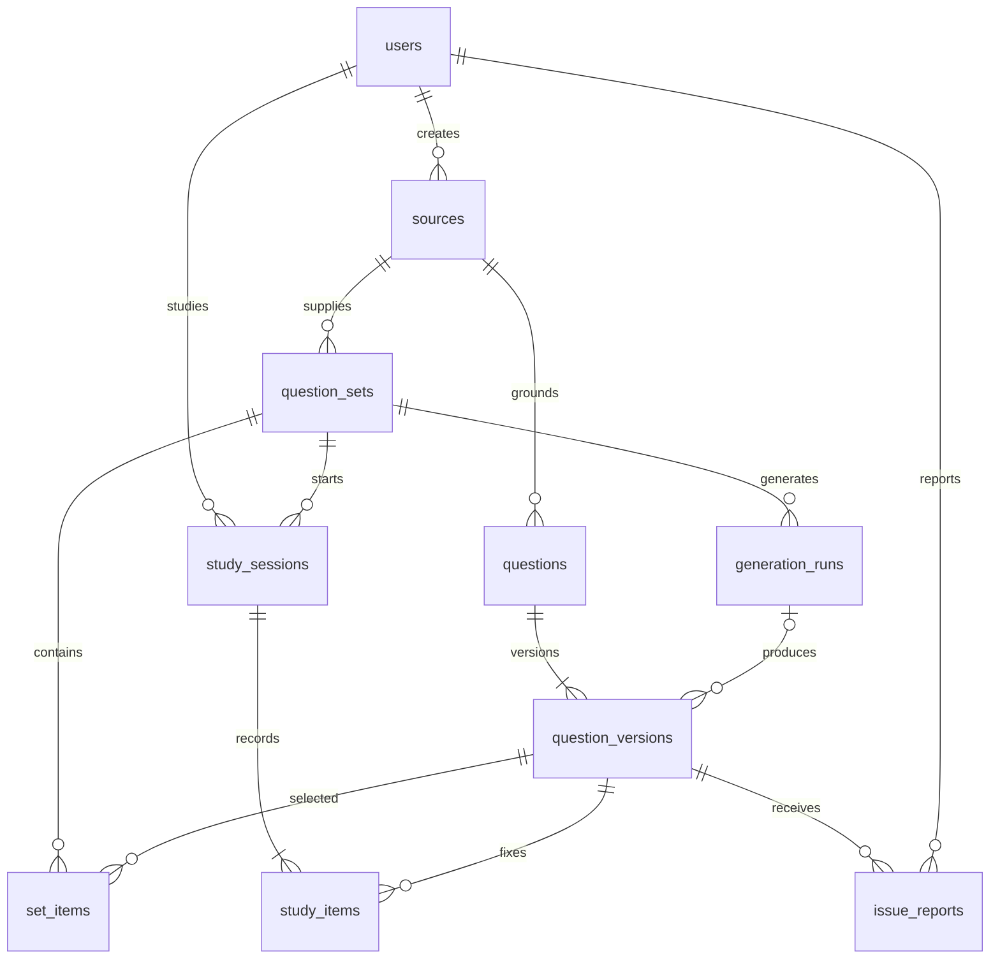

# 初期版の画面一覧と最小DB設計

対象は `app/`。採用済み方針を具体化した設計案。DBや画面はまだ実装していない。

## 初期版の範囲

テキスト教材登録 → Anthropic API で問題生成 → 管理者による確認・採用・セット公開 → 演習 → 履歴・再開を一通り実現する。不備報告と管理者による出題停止も含む。
画像の文字起こし、外部認証、ネイティブアプリ、オフライン同期、複数AI事業者対応は後続とする。モデルはサーバー設定で変更可能にし、実際に使ったモデルを生成記録に残す。

## 画面一覧

| 対象 | 画面・URL案 | 内容と主要操作 |
|---|---|---|
| 学習者 | ホーム `/` | 公開セット一覧、中断した演習。「学習する」「再開する」 |
| 学習者 | セット詳細 `/sets/:id` | タイトル、説明、現在出題可能な問数。「演習を始める」。0問なら開始不可 |
| 学習者 | 演習 `/sessions/:id` | 1問ずつ表示、必要選択数、選択→回答確定、保存状態、解説・引用、次へ、中断、不備報告・スキップ |
| 学習者 | 結果 `/sessions/:id/result` | 正答数・集計対象数、未回答・除外の内訳、各問の振り返り。「誤答を復習する」 |
| 学習者 | 履歴 `/history` | 自分の演習履歴・正答率、結果へのリンク、中断分の再開 |
| 管理者 | 教材一覧 `/admin/sources` | 教材一覧と新規登録への導線 |
| 管理者 | 教材登録 `/admin/sources/new` | タイトルと本文の貼り付け・確認・保存 |
| 管理者 | 教材詳細 `/admin/sources/:id` | 本文確認、生成問数・セット名の指定、生成状況・再試行、作成済みセットへの導線 |
| 管理者 | セット一覧 `/admin/sets` | 下書き・公開・公開停止の一覧 |
| 管理者 | セット編集・確認 `/admin/sets/:id` | 問題・選択肢・正解・解説・引用の確認修正、採用する問題の選択・順序、セット単位で公開。公開済みは閲覧・公開停止・改訂用複製 |
| 管理者 | 不備報告 `/admin/reports` | 一覧と詳細、報告された版・根拠の確認、不備確定または問題なしの判断、修正用セットへの導線 |

専用の管理ダッシュボードや問題編集ページは初期版では追加しない。問題編集はセット確認画面内、不備報告の入力は演習画面内のダイアログとする。両テーマ、空・読み込み・エラー状態を各画面で用意する。
管理者も学習画面を利用できる。認証未導入の初期版はローカル限定とし、外部提供前に権限検証を有効にする。

## DBの基本方針

SQLite + Drizzle ORM。以下は論理設計で、SQL・ドライバー・詳細なインデックスは実装時に定義する。
共通の主キー `id` は整数、日時は UTC の Unix ミリ秒。参照先は外部キーで結び、履歴が参照するデータは物理削除しない。
選択肢は2〜6件のため JSON 配列、正解・選択回答は選択肢IDの配列として保存する。選択肢IDはその問題版内で一意とし、表示順と切り離す。

### コンテンツと利用者（6テーブル）

| テーブル | 主な列（共通の `id` を除く） | 責務 |
|---|---|---|
| `users` | `display_name`, `role` (admin/learner), `created_at` | 初期は管理者1人。管理者も演習可能。外部認証の対応表は後から追加 |
| `sources` | `title`, `body`, `created_by`, `created_at` | 教材本文。問題生成に使用した後は本文を上書きせず、修正内容は新しい教材レコードとして保存 |
| `question_sets` | `source_id`, `title`, `description`, `status` (draft/published/archived), `supersedes_set_id?`, `created_by`, `published_by?`, `published_at?`, `created_at` | 1セットは1教材から作成。公開の単位。改訂セットは旧セットを参照 |
| `questions` | `source_id`, `status` (active/stopped), `created_at` | 同じ問題の版を束ねる識別子。全版の出題停止が必要な場合に使用 |
| `question_versions` | `question_id`, `version_no`, `body`, `choices_json`, `answer_ids_json`, `explanation`, `quote`, `quote_verified`, `reviewed_by?`, `reviewed_at?`, `invalidated_at?`, `invalidated_by?`, `invalidation_reason?`, `generation_run_id?`, `created_at` | 問題文・正解・解説の版。公開した内容は上書きしない。不備判定は版単位で記録 |
| `set_items` | `set_id`, `question_version_id`, `position` | セットで採用した問題版と表示順。公開時に固定する |

`question_versions` は `(question_id, version_no)`、`set_items` は `(set_id, position)` と `(set_id, question_version_id)` をそれぞれ一意にする。同一セットで同じ論理問題の複数版を採用しないこと、セットと問題の教材が一致することもサーバーで検証する。

### 演習と運用（4テーブル）

| テーブル | 主な列（共通の `id` を除く） | 責務 |
|---|---|---|
| `study_sessions` | `user_id`, `set_id`, `mode` (normal/review), `parent_session_id?`, `status` (in_progress/completed), `start_request_key`, `started_at`, `completed_at?` | 演習の単位。復習は元演習を参照する新しい演習として作成 |
| `study_items` | `session_id`, `question_version_id`, `position`, `selected_ids_json?`, `is_correct?`, `answered_at?`, `skipped_at?`, `excluded_reason?`, `excluded_at?` | 開始時に対象版とシャッフル順を保存。回答もこの行に一度だけ保存し、別の回答履歴テーブルは設けない |
| `issue_reports` | `reported_by`, `question_version_id`, `study_item_id?`, `message`, `status` (open/confirmed/dismissed), `resolved_by?`, `resolution_note?`, `created_at`, `resolved_at?` | 学習者の不備報告と管理者の判断 |
| `generation_runs` | `requested_by`, `source_id`, `set_id`, `request_key`, `requested_count`, `model`, `prompt_version`, `status` (running/succeeded/failed/unknown), `error_message?`, `started_at`, `finished_at?` | AI生成の重複防止と結果確認。APIキーを保存しない |

`study_sessions` は `(user_id, start_request_key)`、`study_items` は `(session_id, position)` と `(session_id, question_version_id)`、`generation_runs` は `(requested_by, request_key)` を一意にする。
同じ利用者から同じ版への未解決報告の重複を防ぐ。報告元の演習項目は本人所有かつ同じ問題版であることを確認する。

## 公開・修正・履歴のルール

公開セットの改訂に必要な候補所属・版作成・原子的公開・段階導入は [改訂の実装契約](set-revision-design.md) を参照する。設計済みと実装済みは区別する。

1. AI生成結果は下書きセットと問題版に保存する。管理者が採用する版を `set_items` に登録する。
2. 公開時に、採用問題が1問以上あること、各問の形式・正解・引用照合結果・管理者確認を検証する。引用不一致は警告を見て管理者が判断し、一致を妥当性の保証としない。問題内容の編集後は照合・管理者確認をやり直す。
3. 公開済みセットの構成と問題版の内容は固定する。修正は改訂用の下書きセットと新しい問題版で行い、変更のない版は再利用する。
4. 改訂版の公開と旧セットの公開停止を同一トランザクションで行う。旧版を参照する履歴は残す。
5. 進行中の演習は開始時の版を維持する。セットの公開停止は新規開始を止めるが、問題自体に不備がない進行中の演習や履歴は保持する。
6. 不備確定は該当版の `invalidated_at` 等に記録する。新規出題・進行中の未回答から除外し、過去の正答率の分母・分子からも除外する。回答時の正誤そのものは変更せず、除外理由を結果に表示する。
7. 通常の改訂では過去の成績を再採点しない。不備確定による集計除外とは区別する。

## 回答・再開・復習

- 演習開始時に公開状態・出題停止・不備を検証し、対象の `study_items` を作成する。再開時に再シャッフルしない。
- 回答APIでは本人所有、必要選択数、選択肢ID、現時点の不備・停止状態を検証し、正誤をサーバーで判定する。回答前のレスポンスに正解や解説を含めない。
- 未回答行への条件付き更新で一度だけ確定する。同一回答の再送は保存済み結果を返し、異なる回答への書き換えは拒否する。
- 再開時は次の未回答項目へ進む。出題停止・不備の項目を除外し、画面に理由を示す。
- スキップは未回答のまま保持する。通常の未回答を先に出し、最後にスキップ分へ戻れるようにする。未回答が残る場合は完了とせず、中断・再開できる。
- 対象項目が全て回答済みまたは除外になれば完了。全問除外など集計対象が0件なら、正答率は0%ではなく「集計対象なし」とする。
- 誤答復習は出題可能な誤答版を使って新規演習を作る。初期は新しい版へ自動置換しない。停止・不備の問題は復習からも除外する。

## 生成処理と確認事項

生成の受付記録を先に保存し、AI呼び出しはトランザクション外で行う。問題の保存と生成完了の更新は同一トランザクションで行う。同じ `request_key` の再送は既存状態を返し、新しいAI呼び出しを開始しない。
接続切断・プロセス停止などで結果不明の場合は状態を確認し、成功したか不明な外部API呼び出しの課金まで完全に一度にできるとは保証しない。明示的な再試行は新しい受付として区別する。

最低限確認する条件は、未公開問題を学習者が取得できないこと、他人の履歴を取得できないこと、確定前に正解が漏れないこと、二重送信で回答・問題が増えないこと、再開で順序と回答が維持されること、改訂後も過去の問題版を参照できること、不備確定で履歴を消さず集計から除外できること。
実データの蓄積前にバックアップ・復元手順を整える。
